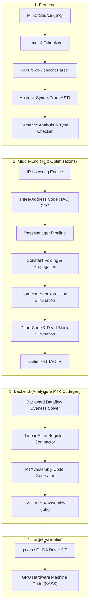

# MiniC-to-PTX: An Educational GPU Compiler

[](LICENSE)
[]()
[]()
[]()
[]()

**MiniC-to-PTX** is a modular, end-to-end optimizing compiler built from scratch in modern C++17. It translates a statically-typed, procedural subset of C (called **MiniC**) into **NVIDIA Parallel Thread Execution (PTX)** virtual assembly for GPU execution.

Designed with clean compiler architecture in mind, MiniC-to-PTX demonstrates the complete compilation lifecycle: lexical analysis, recursive-descent parsing with operator precedence climbing, AST construction, scoped semantic analysis, Three-Address Code (TAC) intermediate representation, control-flow graph (CFG) analysis, iterative dataflow liveness analysis, multi-pass optimizations (Constant Folding, Propagation, Dead-Code Elimination, Common Subexpression Elimination), and target code generation for NVIDIA GPU device functions and compute kernels.

---

## Architecture Overview



---

## Key Features

- **Lexer**: Tokenizes identifiers, keywords, integer literals, comparison/arithmetic/logical operators, and strips single-line (`//`) and multi-line (`/* ... */`) comments with column-accurate error diagnostics.
- **Parser**: Hand-written recursive-descent parser implementing operator precedence climbing across 9 precedence levels with panic-mode error recovery (`synchronize()`).
- **AST & Pretty-Printer**: Strongly-typed polymorphic AST node hierarchy with a Visitor pattern and tree dumper (`--emit-ast`).
- **Semantic Analysis**: Scoped symbol table with lexical block nesting, variable shadowing, type checking, static division-by-zero detection, and function signature verification.
- **Three-Address Code (TAC) IR**: Linear instructions (`add`, `sub`, `mul`, `div`, `rem`, `alloca`, `load`, `store`, `cmp`, `br`, `br_cond`, `ret`, `call`) organized into explicit Basic Blocks with predecessor/successor edge tracking.
- **CFG Visualizer**: Emits Graphviz DOT representations of control flow graphs (`--emit-cfg-dot`).
- **Optimizer Pipeline**:
  - *Constant Folding & Propagation*: Evaluates constant expressions at compile-time, simplifies algebraic identities ($x \times 0 \to 0$), and folds constant conditions.
  - *Common Subexpression Elimination (CSE)*: Value numbering for redundant expression elimination.
  - *Dead-Code Elimination (DCE)*: Prunes unreachable basic blocks, unused arithmetic instructions, and dead alloca slots/stores.
- **Liveness Analysis**: Iterative backward dataflow solver computing live intervals $[start, end]$ and measuring peak register pressure (`--emit-liveness`).
- **Linear Scan Register Allocation**: Coalesces non-overlapping live ranges, minimizing PTX register declaration requirements.
- **PTX Backend**:
  - Emits target declarations: `.version 7.0`, `.target sm_70` (configurable), `.address_size 64`.
  - Supports both device functions (`.func` returning `.param .s32`) and GPU entry compute kernels (`.entry` committing results to global memory via `.param .u64 %out_ptr`).
  - Supports predicated branching (`@%p0 bra label;`).

---

## Directory Structure

```text
MiniC-to-PTX/
├── CMakeLists.txt              # Root build configuration (C++17, CTest)
├── README.md                   # Project documentation
├── LICENSE                     # MIT License
├── .gitignore                  # Git ignore rules
├── docs/                       # Technical specifications
│   ├── architecture.md         # System design & module breakdown
│   ├── language-spec.md        # Formal EBNF grammar & type rules
│   ├── compiler-pipeline.md    # Step-by-step pipeline transformations
│   └── design-decisions.md     # PTX ABI, virtual registers, GPU occupancy
├── include/
│   └── minic/
│       ├── common/             # SourceLocation, DiagnosticEngine
│       ├── lexer/              # Token, Lexer
│       ├── ast/                # AST node hierarchy, ASTVisitor, ASTDumper
│       ├── parser/             # Recursive-descent Parser
│       ├── semantic/           # Type, Symbol, SymbolTable, SemanticAnalyzer
│       ├── ir/                 # Value, Instruction, BasicBlock, Function, Module, IRBuilder, LivenessAnalysis
│       ├── optimizer/          # Pass, PassManager, ConstantFolding, DCE, CSE
│       └── codegen/            # PTXTarget, LinearScanAllocator, PTXEmitter
├── src/                        # Implementations corresponding to include/
│   ├── common/
│   ├── lexer/
│   ├── ast/
│   ├── parser/
│   ├── semantic/
│   ├── ir/
│   ├── optimizer/
│   ├── codegen/
│   └── main.cpp                # Compiler CLI driver
├── tests/
│   ├── test_framework.hpp      # Lightweight, zero-dependency C++ unit test framework
│   ├── test_runner.cpp         # Main entry point for test executables
│   ├── unit/                   # Unit test suites (lexer, parser, sema, ir, opt, codegen, liveness)
│   └── integration/            # Full pipeline integration tests
├── examples/                   # Sample MiniC programs
│   ├── arithmetic.mc
│   ├── conditional.mc
│   ├── loop.mc
│   ├── optimization.mc
│   └── vector_add.mc
└── scripts/
    ├── build.ps1               # Automated PowerShell build script
    ├── test.ps1                # Automated PowerShell test runner
    └── validate_ptx.py         # Cross-platform ptxas validation utility
```

---

## Language Specification (MiniC)

MiniC supports integer arithmetic, lexical scoping, conditionals, loops, and GPU kernel attributes:

```c
// Example: Vector scaling loop with kernel entry point
__global__ int vector_compute(int count, int scale) {
    int total = 0;
    int idx = 0;

    while (idx < count) {
        int val = idx * scale;
        total = total + val;
        idx = idx + 1;
    }

    return total;
}
```

See [docs/language-spec.md](docs/language-spec.md) for the complete EBNF grammar and precedence tables.

---

## Building and Testing

### Prerequisites
- C++17 compatible compiler (GCC 7+, Clang 6+, or MSVC 2019+)
- CMake 3.15 or newer
- Ninja or Make

### Quick Build (PowerShell / Windows)
```powershell
# Run the automated build script
.\scripts\build.ps1

# Run all 9 test suites via CTest
.\scripts\test.ps1
```

### Standard CMake Build
```bash
cmake -S . -B build -G Ninja -DCMAKE_BUILD_TYPE=Release
cmake --build build
ctest --test-dir build --output-on-failure
```

---

## CLI Usage

```text
Usage: minic [options] <input-file>

Options:
  --help              Display this information
  --version           Display compiler version
  --emit-ast          Emit Abstract Syntax Tree representation
  --emit-ir           Emit Three-Address Code intermediate representation
  --emit-ptx          Emit PTX assembly (default)
  --emit-cfg-dot      Emit Control-Flow Graph in Graphviz DOT format
  --emit-liveness     Emit liveness analysis report and register intervals
  --optimize, -O1     Enable compiler optimization passes
  --target=<type>     Target output type: 'func' (default) or 'kernel'
  --arch=<sm>         Target SM architecture (default: sm_70)
  --validate-ptx      Validate generated PTX using NVIDIA ptxas if available
  -o <file>           Output file (defaults to stdout)
```

---

## Optimization Showcase

Consider `examples/optimization.mc`:

```c
int demo_opt(int a, int b) {
    int folded = 100 * 2 + 50;       // Constant folding
    int zero_val = a * 0;            // Algebraic simplification
    int dead_math = b * 999 + 123;   // Dead code
    int expr1 = a * b;               // Common subexpression
    int expr2 = a * b;
    int result = 0;
    if (1) {                         // Constant condition branch folding
        result = folded + expr1 + expr2;
    } else {
        result = 99999;
    }
    return result;
}
```

### Unoptimized IR vs. Optimized IR (`-O1`)

```diff
 define int @demo_opt(int %a, int %b) {
 entry0:
     %a = alloca int
     store %a, %a
     %b = alloca int
     store %b, %b
-    %folded = alloca int
-    %t0 = mul 100, 2
-    %t1 = add %t0, 50
-    store %t1, %folded
-    %zero_val = alloca int
-    %t2 = load %a
-    %t3 = mul %t2, 0
-    store %t3, %zero_val
-    %dead_math = alloca int
-    %t4 = load %b
-    %t5 = mul %t4, 999
-    %t6 = add %t5, 123
-    store %t6, %dead_math
+    %t2 = load %a
+    %t4 = load %b
     %expr1 = alloca int
     %t9 = mul %t2, %t4
     store %t9, %expr1
     %expr2 = alloca int
-    %t10 = load %a
-    %t11 = load %b
-    %t12 = mul %t10, %t11
-    store %t12, %expr2
+    store %t9, %expr2                ; <-- CSE: Reused %t9!
     %result = alloca int
     store 0, %result
-    %p0 = cmp_ne 1, 0
-    br_cond %p0, label %if.then1, label %if.else2
+    br label %if.then1               ; <-- Dead branch eliminated!
 if.then1: ; preds = %entry0
-    %t13 = load %folded
     %t14 = load %expr1
-    %t15 = add %t13, %t14
+    %t15 = add 250, %t14             ; <-- Folded to constant 250!
     %t16 = load %expr2
     %t17 = add %t15, %t16
     store %t17, %result
     br label %if.end3
-if.else2: ; preds = %entry0
-    store 99999, %result
-    br label %if.end3
-if.end3: ; preds = %if.then1 %if.else2
+if.end3: ; preds = %if.then1
     %t18 = load %result
     ret %t18
 }
```

---

## Emitted PTX Assembly

### Device Function Target (`minic examples/arithmetic.mc --emit-ptx`)
```ptx
.version 7.0
.target sm_70
.address_size 64

.visible .func (.param .s32 %retval) compute(
    .param .s32 %param_a,
    .param .s32 %param_b
)
{
    .reg .s32  %r<8>;
    .reg .pred %p<1>;

    ld.param.s32 %r0, [%param_a];
    ld.param.s32 %r1, [%param_b];

L_entry0:
    mov.u32      %r0, %r0;
    mov.u32      %r1, %r1;
    mov.u32      %r3, %r0;
    mov.u32      %r4, %r1;
    mul.lo.s32   %r5, %r4, 2;
    add.s32      %r6, %r3, %r5;
    mov.u32      %r2, %r6;
    mov.u32      %r7, %r2;
    st.param.s32 [%retval], %r7;
    ret;
}
```

### GPU Compute Kernel Target (`minic examples/arithmetic.mc --target=kernel --emit-ptx`)
```ptx
.version 7.0
.target sm_70
.address_size 64

.visible .entry compute(
    .param .u64 %out_ptr,
    .param .s32 %param_a,
    .param .s32 %param_b
)
{
    .reg .s32  %r<8>;
    .reg .pred %p<1>;
    .reg .u64  %rd<1>;

    ld.param.u64 %rd0, [%out_ptr];
    ld.param.s32 %r0, [%param_a];
    ld.param.s32 %r1, [%param_b];

L_entry0:
    mov.u32      %r0, %r0;
    mov.u32      %r1, %r1;
    mov.u32      %r3, %r0;
    mov.u32      %r4, %r1;
    mul.lo.s32   %r5, %r4, 2;
    add.s32      %r6, %r3, %r5;
    mov.u32      %r2, %r6;
    mov.u32      %r7, %r2;
    st.global.s32 [%rd0], %r7;
    ret;
}
```

---

## Test Suite Summary

The compiler includes an extensive automated test suite run via `ctest`:

| Suite | Component | Tests | Status |
| :--- | :--- | :---: | :---: |
| `SanityTests` | Testing framework & DiagnosticEngine | 2 | **Passed** |
| `LexerTests` | Tokenizer, comments, error diagnostics | 6 | **Passed** |
| `ParserTests` | Grammar precedence, AST construction | 7 | **Passed** |
| `SemanticTests` | Scoping, type rules, division-by-zero | 11 | **Passed** |
| `IRTests` | TAC instructions, basic blocks, CFG edges | 5 | **Passed** |
| `OptimizerTests` | Constant folding, propagation, DCE, CSE | 5 | **Passed** |
| `PTXCodegenTests` | Directives, registers, predicates, kernels | 6 | **Passed** |
| `LivenessTests` | Def/Use, dataflow fixpoint, register pressure | 3 | **Passed** |
| `IntegrationEndToEndTests` | Full pipeline on all example programs | 5 | **Passed** |
| **Total** | | **50** | **100% Passing** |

---

## License

This project is licensed under the MIT License - see the [LICENSE](LICENSE) file for details.
