# MiniC-to-PTX Architecture

## 1. High-Level Design

MiniC-to-PTX follows a classic compiler pipeline designed for modularity, clean testability, and clear separation of concerns between target-independent frontend/optimization passes and target-specific backend code emission.

```mermaid
graph LR
    Source[MiniC Source .mc] --> Lexer[Lexer & Tokenizer]
    Lexer --> Parser[Recursive-Descent Parser]
    Parser --> AST[Abstract Syntax Tree]
    AST --> Semantics[Semantic Analyzer & Type Checker]
    Semantics --> IRGen[IR Code Generator]
    IRGen --> TAC_IR[Three-Address Code IR / CFG]
    TAC_IR --> Optimizer[PassManager: ConstFold, DCE, CSE]
    Optimizer --> Opt_IR[Optimized TAC IR]
    Opt_IR --> PTXGen[PTX Code Generator]
    PTXGen --> PTX_Out[Valid PTX Assembly .ptx]
```



---

## 2. Compiler Modules and Responsibilities

### Module 1: Common Diagnostics & Source Tracking (`include/minic/common/`)
- `SourceLocation`: Stores line and column coordinates for every token and AST node.
- `DiagnosticEngine`: Formats standard GCC/Clang-style errors:
  ```
  examples/bad.mc:12:8: error: use of undeclared variable 'z'
      12 |   y = z + 1;
         |       ^
  ```

### Module 2: Lexer (`include/minic/lexer/`)
- Stream-based tokenizer converting raw C++ strings into structured `Token` instances.
- Maintains line and column tracking, handles single-line (`//`) and block (`/* ... */`) comments, recognizes keywords, multi-character operators (`<=`, `==`, `&&`, etc.), and numbers.

### Module 3: Abstract Syntax Tree (`include/minic/ast/`)
- Strongly typed AST node hierarchy rooted at `ASTNode`.
- Separated into:
  - `Decl`: `FunctionDecl`, `ParamDecl`
  - `Stmt`: `CompoundStmt`, `VarDeclStmt`, `ExprStmt`, `IfStmt`, `WhileStmt`, `ReturnStmt`
  - `Expr`: `BinaryExpr`, `UnaryExpr`, `LiteralExpr`, `VarExpr`, `AssignExpr`, `CallExpr`
- Supports `ASTVisitor` for traversals (e.g., AST pretty-printing, semantic analysis, IR lowering).

### Module 4: Semantic Analysis (`include/minic/semantic/`)
- `SymbolTable`: Stack-based scoped symbol table mapping identifier names to `Symbol` metadata (type, declaration location).
- Type checker verifying assignment types, operand types, and function call signatures.
- Static checks for division by zero and unreachable statements after returns.

### Module 5 & 6: Intermediate Representation & Control-Flow Graph (`include/minic/ir/`)
- Three-Address Code (TAC) representation.
- Core classes:
  - `Value`: Base class for operands (`VirtualRegister`, `ConstantInt`, `LabelOperand`).
  - `Instruction`: Explicit opcodes:
    - Arithmetic: `ADD`, `SUB`, `MUL`, `SDIV`, `SREM`
    - Comparison: `CMP_EQ`, `CMP_NE`, `CMP_LT`, `CMP_LE`, `CMP_GT`, `CMP_GE`
    - Memory/Allocation: `ALLOCA`, `LOAD`, `STORE`
    - Control Flow: `BR` (unconditional jump), `BR_COND` (conditional branch on predicate), `RET`, `CALL`
  - `BasicBlock`: Sequence of linear instructions terminating in a control-flow jump/branch/return. Tracks explicit predecessors and successors.
  - `Function`: Contains a collection of BasicBlocks with an explicit entry block.
  - `Module`: Top-level container of functions and globals.
- Textual IR format for debugging and verification.

### Module 7: Optimizer (`include/minic/optimizer/`)
- `PassManager`: Pipeline coordinator running transformation passes until fixpoint or configured order.
- Individual passes:
  1. `ConstantFoldingPass`: Folds compile-time arithmetic and comparison expressions.
  2. `ConstantPropagationPass`: Replaces register reads with known constant values.
  3. `DeadCodeEliminationPass`: Removes instructions producing values that are never read and have no side effects, as well as dead basic blocks.

### Module 8: PTX Code Generator (`include/minic/codegen/`)
- Translates TAC IR into valid PTX assembly adhering to NVIDIA PTX ISA specifications.
- Handles target architectures (e.g., `.target sm_70` or `.target sm_80`), address sizes (`.address_size 64`), and PTX virtual register declarations (`.reg .s32`, `.reg .pred`, `.reg .u64`).
- Implements two target modes:
  1. `.func` — standard PTX device function with direct parameter return.
  2. `.entry` — GPU compute kernel writing output values to global memory via parameter pointers.
