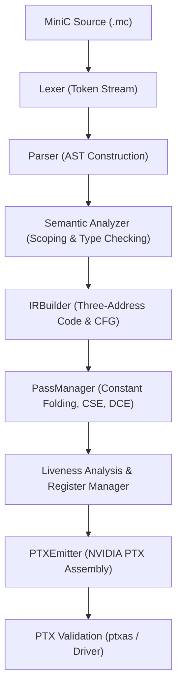

# MiniC-to-PTX Compiler Pipeline

This document details the exact transformations a MiniC program undergoes from source text through to NVIDIA PTX assembly.



---

## Complete Walkthrough Example: `examples/arithmetic.mc`

### 1. Source Input
```c
int compute(int a, int b) {
    int c;
    c = a + b * 2;
    return c;
}
```

---

### 2. Abstract Syntax Tree (`minic input.mc --emit-ast`)
```text
Program [examples/arithmetic.mc:1:1]
  FunctionDecl: int compute [examples/arithmetic.mc:1:1]
    Parameters:
      Param: int a [examples/arithmetic.mc:1:13]
      Param: int b [examples/arithmetic.mc:1:20]
    CompoundStmt [examples/arithmetic.mc:1:27]
      VarDeclStmt: int c [examples/arithmetic.mc:2:5]
      ExprStmt [examples/arithmetic.mc:3:5]
        AssignExpr: c = [examples/arithmetic.mc:3:7]
          BinaryExpr: '+' [examples/arithmetic.mc:3:11]
            VarExpr: a [examples/arithmetic.mc:3:9]
            BinaryExpr: '*' [examples/arithmetic.mc:3:15]
              VarExpr: b [examples/arithmetic.mc:3:13]
              LiteralExpr: 2 [examples/arithmetic.mc:3:17]
      ReturnStmt [examples/arithmetic.mc:4:5]
        VarExpr: c [examples/arithmetic.mc:4:12]
```

---

### 3. Intermediate Representation (`minic input.mc --emit-ir`)
```llvm
; ModuleID = 'examples/arithmetic.mc'

define int @compute(int %a, int %b) {
entry0:
    %a = alloca int
    store %a, %a
    %b = alloca int
    store %b, %b
    %c = alloca int
    %t0 = load %a
    %t1 = load %b
    %t2 = mul %t1, 2
    %t3 = add %t0, %t2
    store %t3, %c
    %t4 = load %c
    ret %t4
}
```

---

### 4. Liveness Analysis & Register Span (`minic input.mc --emit-liveness`)
```text
============================================================
 Liveness Analysis Report: Function @compute
============================================================

[1] Basic Block Liveness Summary:
  Block %entry0:
    Def    : {%t4, %t3, %t2, %t1, %t0}
    Use    : {}
    Live-In: {}
    Live-Out: {}

[2] Live Intervals:
  Register | Type       | Start Inst | End Inst | Span (Length)
  ---------+------------+------------+----------+--------------
  %t0      | int (s32)  |          5 |        8 |      4
  %t1      | int (s32)  |          6 |        7 |      2
  %t2      | int (s32)  |          7 |        8 |      2
  %t3      | int (s32)  |          8 |        9 |      2
  %t4      | int (s32)  |         10 |       11 |      2

[3] Peak Register Pressure: 3 simultaneous 32-bit registers
============================================================
```

---

### 5. Emitted NVIDIA PTX Assembly (`minic input.mc --emit-ptx`)
```ptx
//
// Generated by MiniC-to-PTX Compiler
// Target Architecture: sm_70
// PTX ISA Version: 7.0
//
.version 7.0
.target sm_70
.address_size 64

.visible .func (.param .s32 %retval) compute(
    .param .s32 %param_a,
    .param .s32 %param_b
)
{
    .reg .s32  %r<8>;
    .reg .pred %p<1>;

    ld.param.s32 %r0, [%param_a];
    ld.param.s32 %r1, [%param_b];

L_entry0:
    mov.u32      %r0, %r0;
    mov.u32      %r1, %r1;
    mov.u32      %r3, %r0;
    mov.u32      %r4, %r1;
    mul.lo.s32   %r5, %r4, 2;
    add.s32      %r6, %r3, %r5;
    mov.u32      %r2, %r6;
    mov.u32      %r7, %r2;
    st.param.s32 [%retval], %r7;
    ret;
}
```

---

### 6. Emitted NVIDIA PTX GPU Entry Kernel (`minic input.mc --target=kernel --emit-ptx`)
```ptx
//
// Generated by MiniC-to-PTX Compiler
// Target Architecture: sm_70
// PTX ISA Version: 7.0
//
.version 7.0
.target sm_70
.address_size 64

.visible .entry compute(
    .param .u64 %out_ptr,
    .param .s32 %param_a,
    .param .s32 %param_b
)
{
    .reg .s32  %r<8>;
    .reg .pred %p<1>;
    .reg .u64  %rd<1>;

    ld.param.u64 %rd0, [%out_ptr];
    ld.param.s32 %r0, [%param_a];
    ld.param.s32 %r1, [%param_b];

L_entry0:
    mov.u32      %r0, %r0;
    mov.u32      %r1, %r1;
    mov.u32      %r3, %r0;
    mov.u32      %r4, %r1;
    mul.lo.s32   %r5, %r4, 2;
    add.s32      %r6, %r3, %r5;
    mov.u32      %r2, %r6;
    mov.u32      %r7, %r2;
    st.global.s32 [%rd0], %r7;
    ret;
}
```
